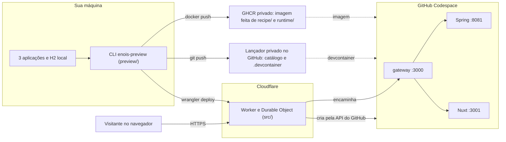

# enois-preview

Ferramenta de linha de comando que publica um link de preview do Énóis para um PR: quem abre o link recebe o app inteiro rodando, com dados realistas, num ambiente descartável.

[English](docs/en/README.md) · [Conceitos](docs/pt-BR/CONCEPTS.md) · [Fluxo](docs/pt-BR/FLOW.md) · [Receitas](docs/pt-BR/RECIPES.md) · [Tutorial](docs/pt-BR/TUTORIAL.md) · [Histórico](CHANGELOG.md)

## O problema

Para revisar um PR do Énóis de verdade, é preciso o backend, o frontend e o design system rodando juntos, com dados que pareçam reais. Montar isso na máquina de cada revisor é lento e frágil.

O enois-preview resolve isso para quem abre o PR (o operador). Você roda `enois-preview publish <cenario>` no seu terminal e recebe um link HTTPS. Quando alguém abre o link, um GitHub Codespace sobe sozinho com as três aplicações nos seus commits e com uma cópia sanitizada dos seus dados. Depois de dez minutos sem uso, o ambiente é apagado.

Em resumo:
- **No `publish`:** a ferramenta confere que as fontes estão comitadas, copia os dados só quando precisa, congela tudo numa revisão imutável, constrói a imagem, grava a configuração no seu lançador privado, publica o Worker e só informa sucesso depois de abrir o link e conferir o resultado.
- **Na visita:** o Worker da Cloudflare cria o Codespace, mostra as contas e senhas geradas no boot e encaminha a navegação até o app.

O passo a passo de cada lado está em [Fluxo](docs/pt-BR/FLOW.md).

## Onde roda o quê



## Comandos

| Comando | Para que serve | Receita |
| --- | --- | --- |
| `enois-preview setup --config <arquivo>` | Confere a infraestrutura existente e registra a confirmação inicial dos planos gratuitos | [Instalar](docs/pt-BR/RECIPES.md#1-instalar-ou-trocar-a-ferramenta-para-outro-commit-fixado) · [Meus dados](docs/pt-BR/RECIPES.md#8-usar-meus-próprios-dados) |
| `enois-preview publish <cenario>` | Publica os commits atuais com os dados congelados do cenário | [Código novo](docs/pt-BR/RECIPES.md#3-publicar-de-novo-só-com-código-novo) |
| `enois-preview publish <cenario> --refresh-data` | Captura dados novos e publica | [Dados novos](docs/pt-BR/RECIPES.md#4-publicar-com-dados-novos) |
| `enois-preview resume <revisao-completa>` | Continua uma publicação que falhou, sem recapturar dados | [Retomar](docs/pt-BR/RECIPES.md#5-retomar-uma-publicação-que-falhou) |
| `enois-preview source-digest` | Só lê: informa o digest lógico do banco de origem parado | [Conferir o banco](docs/pt-BR/RECIPES.md#7-conferir-se-o-banco-mudou) |

`enois-preview --help` mostra o resumo. Todos aceitam `--home <diretorio>` para usar outra instalação privada.

## Requisitos

- Linux com Node 24.x (`>=24 <25`); o `.nvmrc` seleciona a família 24.
- Git, Java 25 e Javac, Docker, `fuser`, `flock` e GitHub CLI.
- Autenticação no GitHub, no GHCR e na Cloudflare.
- Sua própria infraestrutura privada: um repositório lançador privado, um pacote GHCR privado e um Worker da Cloudflare. Para criá-la, siga o [diagnóstico de instalação](docs/diagnostics/installation.pt-BR.md).
- O driver H2 deve corresponder ao banco configurado. A receita da imagem já traz `ffmpeg` e o modelo local de classificação de imagens; uploads novos não usam serviço externo de escrita de mídia.

A ferramenta usa TypeScript estrito e ESM, compilado explicitamente; Python não é requisito. Para desenvolvimento, use `npm ci --ignore-scripts`, `npm run build`, `npm run typecheck`, `npm test` e `npm run check`. O teste recompila antes de executar.

## Instalação

Instale pelo instalador, no commit público completo fixado em `tool.lock.json` no lançador privado. O instalador baixa esse commit do GitHub, compila fora dos seus checkouts em `~/.local/share/enois-preview/<COMMIT>`, grava em `install.json` os hashes da fonte e do `dist`, aponta `current` para essa instalação e liga o comando `enois-preview`.

```sh
git clone https://github.com/renanfranca/enois-preview.git /caminho/temporario/enois-preview
cd /caminho/temporario/enois-preview
git checkout --detach <COMMIT_PUBLICO_FIXADO>
npm ci --ignore-scripts
npm run build
node dist/scripts/install-tool.js --commit <COMMIT_PUBLICO_FIXADO>
cd ~/.local/share/enois-preview/current
npx --no-install playwright install chromium
node dist/example/prepare.js /caminho/novo/workspace-ficticio
enois-preview setup --config /caminho/novo/workspace-ficticio/.preview/config.json
enois-preview publish meu-cenario
enois-preview publish meu-cenario --refresh-data
enois-preview resume <revisao-completa>
enois-preview source-digest
```

Atenção:
- `publish` e `resume` recalculam os hashes e recusam, antes de qualquer efeito, uma instalação que difira do registro ou do `toolCommit`.
- A instalação é imutável: para outra versão, instale outro commit. Não execute `npm run` dentro dela, porque isso recompila o `dist`.
- Um checkout de desenvolvimento não publica, nem limpo no mesmo commit.
- Revisões congeladas pela 0.3.1 ou anteriores só são retomadas pelo executor original: um checkout limpo no commit delas, com `npm run build`.
- Configuração, dados, journals, proveniência e catálogo usam `format: "enois-preview-ts-v1"`. A instalação privada padrão fica em `~/.config/enois-preview-ts`. Registros antigos com `schema` ou sem esse `format` são recusados antes de alterações: crie uma instalação e um catálogo novos, sem copiar a confirmação nem converter journals Python. Arquivos antigos e histórico são preservados, sem promessa de retomada ou de funcionamento dos links anteriores.

A primeira publicação, com dados fictícios, está no [tutorial](docs/pt-BR/TUTORIAL.md).

## Mapa da documentação

| Documento | Quando ler |
| --- | --- |
| [Conceitos](docs/pt-BR/CONCEPTS.md) | Antes de tudo: revisão, captura, lançador, journal, lease |
| [Fluxo](docs/pt-BR/FLOW.md) | Para entender o que acontece no `publish` e na visita |
| [Tutorial](docs/pt-BR/TUTORIAL.md) | Na primeira publicação, com o exemplo fictício |
| [Receitas](docs/pt-BR/RECIPES.md) | No dia a dia: publicar de novo, refresh, retomar, interrupções, erros |
| [Diagnóstico](docs/diagnostics/README.md) | Para preparar a infraestrutura ou investigar uma falha |
| [Guia para LLM](docs/pt-BR/LLM.md) | Se um assistente for ajudar você a operar |
| [Histórico de versões](CHANGELOG.md) | Para saber o que mudou em cada versão |

## Limites e custos

- A ferramenta não comita nem altera as três aplicações. Ela recusa fontes com mudanças staged, unstaged ou arquivos não rastreados.
- O primeiro `publish` de um cenário captura dados e para somente o backend identificado. As publicações seguintes usam os commits atuais e os dados congelados, sem ler ou parar o banco local. `--refresh-data` faz outra captura; uma falha preserva a versão completa anterior. As fontes são exportadas por commit e o pacote do design system é construído novamente.
- Os visitantes compartilham contas, dados e capacidade: 20 MiB por arquivo novo e 256 MiB por ambiente. As mídias da semente não gastam essa capacidade. O boot restaura a semente e gera senhas novas; alterações e uploads são descartáveis.
- Dez minutos sem interação reconhecida iniciam a exclusão. Polling não renova o prazo. Disponibilidade e franquias das plataformas limitam essa proteção; um link imutável não garante um ambiente permanentemente ativo.
- A conferência dos planos gratuitos e do bloqueio de gastos ocorre somente no `setup`. Publicar, retomar e abrir links não exigem renovação. A ferramenta não solicita cartão, não contrata recursos e não ativa planos pagos. A confirmação humana não audita faturamento por API. Consulte [a cobrança do Codespaces](https://docs.github.com/en/billing/concepts/product-billing/github-codespaces) e [os limites gratuitos de Durable Objects](https://developers.cloudflare.com/durable-objects/platform/pricing/).
- Este é um uso temporário associado ao desenvolvimento e teste do projeto. Os [termos do Codespaces](https://docs.github.com/en/site-policy/github-terms/github-terms-for-additional-products-and-features#codespaces) restringem uso desproporcional como servidor e hospedagem de aplicações de produção. O funcionamento técnico não demonstra aprovação desta arquitetura pelo GitHub.

## Para auditar

A publicação só informa sucesso após as verificações públicas. O resultado individual de cada critério de aceite, com as evidências por versão, está em [VALIDATION.md](VALIDATION.md); consulte esse arquivo antes de considerar uma revisão pronta para compartilhar. Para falhas e recuperação, veja o [diagnóstico](docs/diagnostics/README.md).

## Licença

Código sob [GPLv3](LICENSE), preservando os avisos dos projetos consumidos. Dados locais e credenciais devem permanecer fora do repositório público. Sanitizar autenticação não anonimiza o conteúdo escolhido pelo operador.
