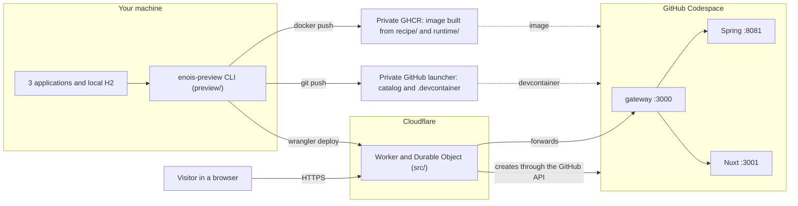
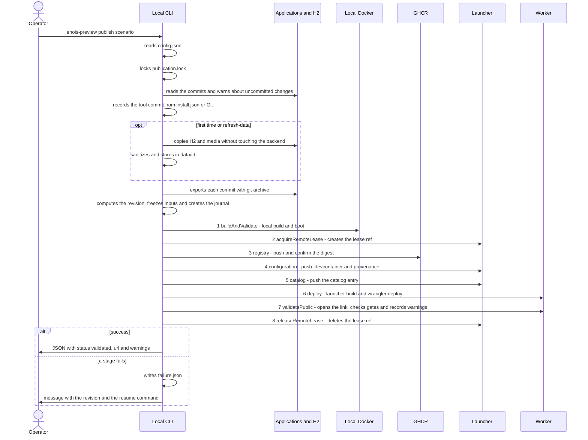
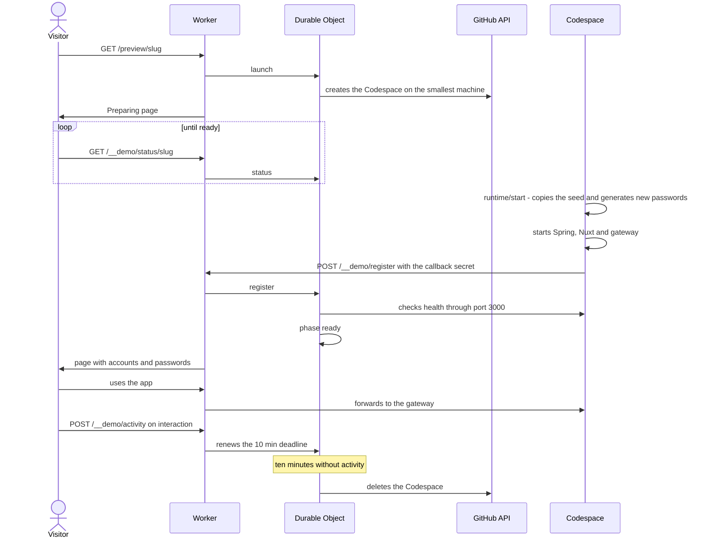

# Flow

[Português do Brasil](../pt-BR/FLOW.md) · [README](README.md) · [Concepts](CONCEPTS.md) · [Recipes](RECIPES.md)

Three diagrams: where each part runs, what happens during `publish`, and what happens when someone opens the link. Terms are explained in [Concepts](CONCEPTS.md).

## Where things run

1. **Your machine:** you run the CLI in your local terminal. It reads the commits of the three applications and, when needed, the H2 database and media.
2. **GHCR:** the CLI builds a Docker image locally with the recipe (`recipe/`), the runtime (`runtime/`), the exported sources and the frozen data, and pushes it to your private GHCR package.
3. **Launcher:** the CLI writes the Codespace configuration and the catalog entry to your private repository.
4. **Cloudflare:** the CLI deploys the launcher's Worker with `wrangler deploy`. The Worker answers the link, and each scenario has a Durable Object that controls the Codespace lifecycle.
5. **Codespace:** created by the Worker when someone opens the link. Inside it, the gateway on port 3000 receives all traffic, sends `/api` to Spring on port 8081 and everything else to Nuxt on port 3001.
6. **Visitor:** talks only to the Worker over HTTPS. They never reach the Codespace directly.

## What happens during `publish`

1. **Configuration:** the CLI reads `config.json` from your private installation. Without `setup`, it stops here. Fields no longer used, such as `service`, `toolCommit` or `installation`, produce the `ignored-config-fields` warning.
2. **Local lock:** `publication.lock` prevents two `publish` or `resume` runs at once on the same `state`.
3. **Sources:** the CLI reads the committed `HEAD` of each application. Staged, unstaged or untracked changes produce the `source-dirty` warning and are left out.
4. **Tool commit:** the CLI recomputes the installation hashes and records its commit with `toolVerified: true`. A development checkout or a changed installation records its Git `HEAD` (or `null`) with the `unverified-tool` warning.
5. **Capture:** only on the scenario's first publication, with `--refresh-data`, or when `--accounts` selects other accounts than the frozen data. The CLI copies H2 and media without stopping, starting or waiting for the backend; a file in use or changed during the copy produces a warning. If no accounts are configured, `--accounts` selects them, or the CLI asks in the terminal.
6. **Export:** each application is exported from its current commit with `git archive`, outside your checkouts.
7. **Freezing:** the CLI computes the revision and, if it does not exist yet, copies data, sources, recipe, runtime, Worker and `dist` into `operations/<revision>/frozen` and creates the journal.
8. **The publisher's eight stages** (`Publisher` in `preview/remote.ts`), in this order:
   1. `buildAndValidate`: builds the image locally, without running application tests, and validates boot in a local container.
   2. `acquireRemoteLease`: creates the ref `refs/heads/enois-preview-publication-lease` in the launcher. If another operation holds it, waits up to `leaseWaitSeconds`; with `--force-lease`, deletes it, records the takeover and reports `lease-forced`.
   3. `registry`: pushes the image to GHCR with the tag `preview-<revision>` and from then on uses it by digest.
   4. `configuration`: pushes `.devcontainer/<slug>/` and the provenance to the launcher.
   5. `catalog`: pushes the new entry in `catalog/scenarios.json`.
   6. `deploy`: in the launcher checkout, runs `npm ci --ignore-scripts`, `npm run build` and `wrangler deploy`. A launcher pinned to another tool commit produces the `launcher-pin` warning and is not repinned.
   7. `validatePublic`: opens the public link. Readiness, revision identity and the login of each selected account are gates; media, decoding, permissions and cookies become warnings.
   8. `releaseRemoteLease`: deletes the lease ref.
9. **Result:** on success, the CLI prints JSON with `status: "validated"`, the `url` and `warnings`. On failure, it writes `failure.json` and reports the stage, the full revision and the command `enois-preview resume <revision>`.

`resume` runs steps 1, 2 and 4 and skips sources, capture, export and freezing (steps 3, 5, 6 and 7): it reads the revision's journal, checks the frozen files and continues the eight stages from what was already recorded. It never recaptures data.

## What happens when someone opens the link

1. **Opening:** the visitor opens `/preview/<slug>`. The Worker checks that the slug is in the catalog and asks that scenario's Durable Object to start.
2. **Creation:** if no Codespace exists, the Durable Object creates one through the GitHub API, on the smallest available machine. If GitHub refuses, the page asks to try again in ten minutes.
3. **Waiting:** the visitor sees a "preparing" page that refreshes itself by polling `/__demo/status/<slug>`.
4. **Boot:** in the Codespace, `runtime/start.ts` copies the database and media seed into `/tmp`, generates new passwords for the selected accounts and starts Spring (port 8081), Nuxt (port 3001) and the gateway (port 3000).
5. **Registration:** `runtime/register-codespace.ts` calls `/__demo/register` with the callback secret, the Codespace name, the private port token and the credentials. The Durable Object checks owner, repository, machine and app health before marking the phase ready.
6. **Credentials:** the visitor gets the page with the accounts and the new passwords. Passwords appear only there, never in the CLI report.
7. **Use:** from then on, the Worker forwards requests to the Codespace gateway.
8. **Activity:** the gateway injects a script into HTML pages. Keyboard, touch, wheel and pointer movement on a visible tab send `/__demo/activity` at most every 15 seconds, which renews the deadline. The waiting page and credential reads do not renew it.
9. **Deletion:** ten minutes after the last activity, the Durable Object deletes the Codespace. Whoever opens the link later sees that the environment ended and can start a new one, which returns to the seed with new passwords.
