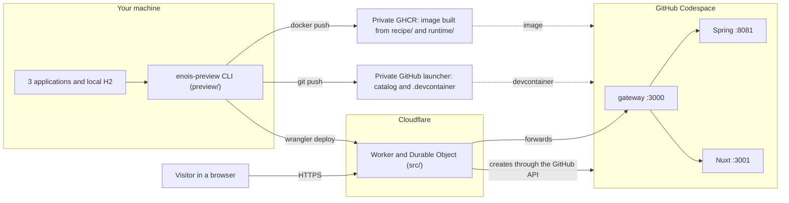

# enois-preview

A command line tool that publishes an Énóis preview link for a PR: whoever opens the link gets the whole app running, with realistic data, in a disposable environment.

[Português do Brasil](../../README.md) · [Concepts](CONCEPTS.md) · [Flow](FLOW.md) · [Recipes](RECIPES.md) · [Tutorial](TUTORIAL.md) · [Changelog](CHANGELOG.md)

## The problem

Reviewing an Énóis PR properly needs the backend, the frontend and the design system running together, with data that looks real. Setting that up on every reviewer's machine is slow and fragile.

enois-preview solves this for whoever opens the PR (the operator). You run `enois-preview publish <scenario>` in your terminal and get an HTTPS link. When someone opens the link, a GitHub Codespace boots by itself with the three applications at your commits and a sanitized copy of your data. After ten minutes without use, the environment is deleted.

In short:
- **On `publish`:** the tool checks that sources are committed, copies data only when needed, freezes everything into an immutable revision, builds the image, writes the configuration to your private launcher, deploys the Worker, and reports success only after opening the link and checking the result.
- **On a visit:** the Cloudflare Worker creates the Codespace, shows the accounts and passwords generated at boot, and forwards browsing to the app.

Each side, step by step, is in [Flow](FLOW.md).

## Where things run



## Commands

| Command | Purpose | Recipe |
| --- | --- | --- |
| `enois-preview setup --config <file>` | Checks existing infrastructure and records the initial Free plan confirmation | [Install](RECIPES.md#1-install-or-switch-the-tool-to-another-pinned-commit) · [My data](RECIPES.md#8-use-my-own-data) |
| `enois-preview publish <scenario>` | Publishes current commits with the scenario's frozen data | [New code](RECIPES.md#3-publish-again-with-new-code-only) |
| `enois-preview publish <scenario> --refresh-data` | Captures new data and publishes | [New data](RECIPES.md#4-publish-with-new-data) |
| `enois-preview resume <full-revision>` | Continues a failed publication, without recapturing data | [Resume](RECIPES.md#5-resume-a-failed-publication) |
| `enois-preview source-digest` | Read only: reports the logical digest of the stopped source database | [Check the database](RECIPES.md#7-check-whether-the-database-changed) |

`enois-preview --help` prints the summary. Every command accepts `--home <directory>` to use another private installation.

## Requirements

- Linux with Node 24.x (`>=24 <25`); `.nvmrc` selects the 24 family.
- Git, Java 25 and Javac, Docker, `fuser`, `flock` and GitHub CLI.
- GitHub, GHCR and Cloudflare authentication.
- Your own private infrastructure: a private launcher repository, a private GHCR package and a Cloudflare Worker. To create it, follow [installation diagnostics](../diagnostics/installation.en.md).
- The H2 driver must match the configured database. The image recipe includes `ffmpeg` and a local image classification model; new uploads require no external storage write service.

The tool uses strict TypeScript and ESM, built explicitly; Python is not required. Development commands are `npm ci --ignore-scripts`, `npm run build`, `npm run typecheck`, `npm test` and `npm run check`. Tests rebuild before execution.

## Installation

Install with the installer, at the full public commit pinned by the private launcher's `tool.lock.json`. The installer downloads that commit from GitHub, builds it outside your checkouts in `~/.local/share/enois-preview/<COMMIT>`, records the hashes of its source and `dist` in `install.json`, points `current` at it and links the `enois-preview` command.

```sh
git clone https://github.com/renanfranca/enois-preview.git /absolute/temporary/enois-preview
cd /absolute/temporary/enois-preview
git checkout --detach <PINNED_PUBLIC_COMMIT>
npm ci --ignore-scripts
npm run build
node dist/scripts/install-tool.js --commit <PINNED_PUBLIC_COMMIT>
cd ~/.local/share/enois-preview/current
npx --no-install playwright install chromium
node dist/example/prepare.js /absolute/new/fictional-workspace
enois-preview setup --config /absolute/new/fictional-workspace/.preview/config.json
enois-preview publish my-scenario
enois-preview publish my-scenario --refresh-data
enois-preview resume <full-revision>
enois-preview source-digest
```

Attention:
- `publish` and `resume` recompute the hashes and refuse, before any effect, an installation that differs from its record or from `toolCommit`.
- Installations are immutable: install another commit for another version. Do not run `npm run` inside one, because it rebuilds `dist`.
- A development checkout cannot publish, even when clean at the same commit.
- Revisions frozen by 0.3.1 or earlier resume only with their original executor: a clean checkout at their commit, built with `npm run build`.
- Configuration, data, journals, provenance and catalog use `format: "enois-preview-ts-v1"`. The default private installation is `~/.config/enois-preview-ts`. Records with historical `schema` fields or without this `format` are refused before mutation: start a fresh installation and catalog, without copying the old confirmation or converting Python journals. Previous files and Git history stay preserved, without a promise to resume old operations or retain old links.

The first publication, with fictional data, is in the [tutorial](TUTORIAL.md).

## Documentation map

| Document | When to read |
| --- | --- |
| [Concepts](CONCEPTS.md) | First: revision, capture, launcher, journal, lease |
| [Flow](FLOW.md) | To understand what happens on `publish` and on a visit |
| [Tutorial](TUTORIAL.md) | For the first publication, with the fictional example |
| [Recipes](RECIPES.md) | Day to day: publish again, refresh, resume, interruptions, errors |
| [Diagnostics](../diagnostics/README.md) | To prepare infrastructure or investigate a failure |
| [LLM guide](LLM.md) | If an assistant will help you operate |
| [Changelog](CHANGELOG.md) | To see what changed in each release |

## Limits and costs

- Publication never changes or commits the three source applications. It refuses sources with staged, unstaged or untracked changes.
- A scenario's first `publish` captures data with only the identified backend stopped. Later publications use current application commits and frozen data without reading or stopping the local database. `--refresh-data` requests a new capture; failure preserves the previous complete version. Sources come from Git commits, including a newly built design system package.
- Visitors share accounts, mutable state and upload capacity: 20 MiB per new file and 256 MiB per environment, excluding seed media. Boot restores seed state and generates new passwords; runtime changes and uploads are disposable.
- Ten minutes without recognized interaction starts deletion; polling does not renew activity. Platform availability and quotas limit timely deletion. An immutable link does not promise an environment that is always running.
- Free plan and spending block verification occurs only at `setup`. Publish, resume and link visits require no renewal. The tool never asks for a card, purchases resources or enables paid plans. Human confirmation is not a billing API audit. Read [Codespaces billing](https://docs.github.com/en/billing/concepts/product-billing/github-codespaces) and [Durable Objects Free limits](https://developers.cloudflare.com/durable-objects/platform/pricing/).
- This is a temporary development and testing preview associated with the project. [Codespaces terms](https://docs.github.com/en/site-policy/github-terms/github-terms-for-additional-products-and-features#codespaces) restrict disproportionate server use and hosting production facing applications. Technical operation does not establish GitHub approval of this architecture.

## For auditing

Publication reports success only after the public checks pass. The individual acceptance results, with evidence per release, are in [VALIDATION.md](../../VALIDATION.md); read it before treating a revision as ready to share. For failures and recovery, see [diagnostics](../diagnostics/README.md).

## License

Tool code is [GPLv3](../../LICENSE); retain notices from consumed projects. Local datasets and credentials belong outside public Git history. Sanitizing authentication does not anonymize operator chosen content.
