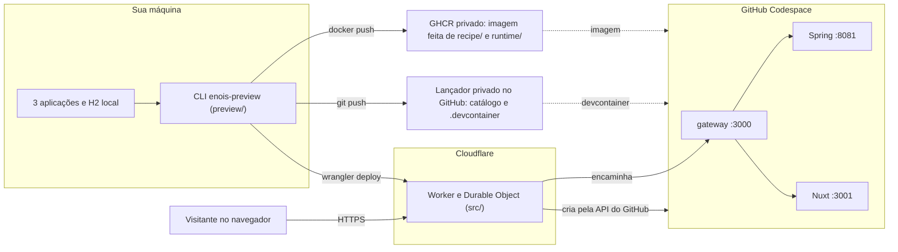
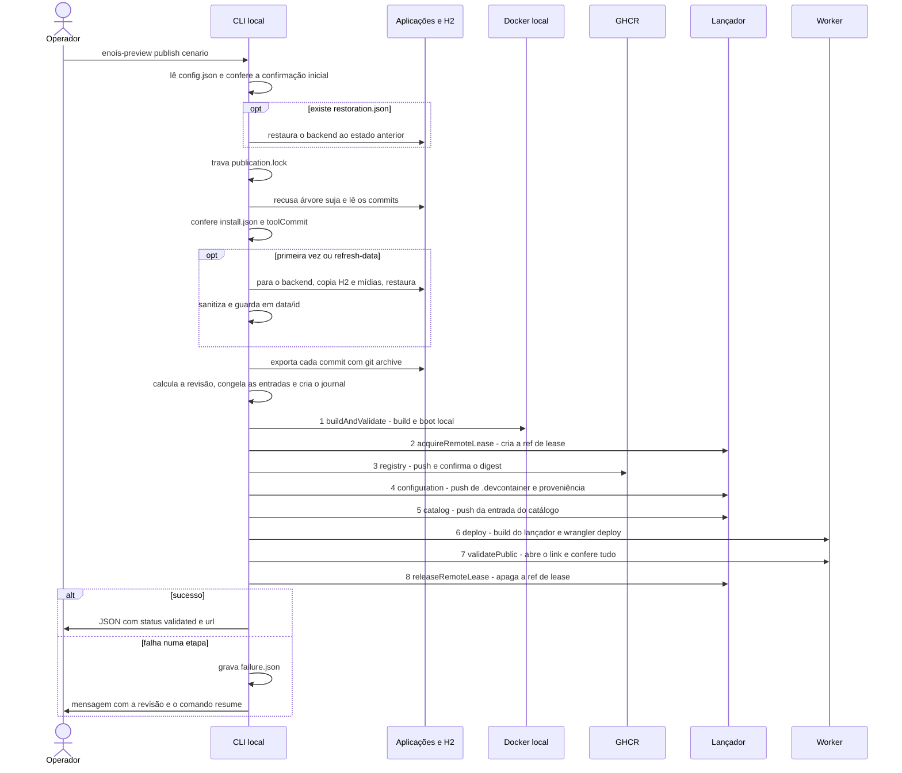
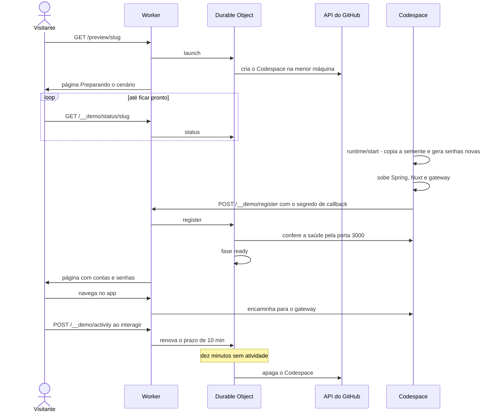

# Fluxo

[English](../en/FLOW.md) · [README](../../README.md) · [Conceitos](CONCEPTS.md) · [Receitas](RECIPES.md)

Três diagramas: onde cada parte roda, o que acontece no `publish` e o que acontece quando alguém abre o link. Os termos estão explicados em [Conceitos](CONCEPTS.md).

## Onde roda o quê

1. **Sua máquina:** você roda o CLI no terminal local. Ele lê os commits das três aplicações e, quando precisa, o banco H2 e as mídias.
2. **GHCR:** o CLI constrói localmente uma imagem Docker com a receita (`recipe/`), o runtime (`runtime/`), as fontes exportadas e os dados congelados, e envia essa imagem ao seu pacote privado no GHCR.
3. **Lançador:** o CLI grava no seu repositório privado a configuração do Codespace e a entrada do catálogo.
4. **Cloudflare:** o CLI publica o Worker do lançador com `wrangler deploy`. O Worker atende o link e cada cenário tem um Durable Object que controla o ciclo de vida do Codespace.
5. **Codespace:** criado pelo Worker quando alguém abre o link. Dentro dele, o gateway na porta 3000 recebe todo o tráfego, envia `/api` para o Spring na porta 8081 e o resto para o Nuxt na porta 3001.
6. **Visitante:** só fala com o Worker por HTTPS. Ele nunca acessa o Codespace diretamente.

## O que acontece no `publish`

1. **Configuração:** o CLI lê `config.json` da sua instalação privada. Sem a confirmação inicial do `setup`, ele para aqui.
2. **Recuperação pendente:** se um comando anterior deixou `restoration.json`, o CLI primeiro devolve o backend ao estado registrado.
3. **Trava local:** `publication.lock` impede dois `publish` ou `resume` ao mesmo tempo no mesmo `state`.
4. **Árvore limpa:** se qualquer uma das três aplicações tiver mudanças staged, unstaged ou arquivos não rastreados, o CLI recusa sem parar nenhum serviço.
5. **Instalação verificada:** o CLI recalcula os hashes da instalação e confere se ela pertence ao `toolCommit` configurado.
6. **Captura:** só na primeira publicação do cenário ou com `--refresh-data`. O backend é parado só se estava rodando e volta ao estado anterior logo depois da cópia. Se nenhuma conta estiver configurada, o CLI pergunta no terminal quais IDs usar.
7. **Exportação:** cada aplicação é exportada do commit atual com `git archive`, fora dos seus checkouts.
8. **Congelamento:** o CLI calcula a revisão e, se ela ainda não existe, copia dados, fontes, receita, runtime, Worker e `dist` para `operations/<revisao>/frozen` e cria o journal.
9. **As oito etapas do publicador** (`Publisher` em `preview/remote.ts`), nesta ordem:
   1. `buildAndValidate`: constrói a imagem localmente e valida o boot num contêiner local.
   2. `acquireRemoteLease`: cria a ref `refs/heads/enois-preview-publication-lease` no lançador. Se outra operação a tem, espera até `leaseWaitSeconds`.
   3. `registry`: envia a imagem ao GHCR com a tag `preview-<revisao>` e passa a usá-la pelo digest.
   4. `configuration`: faz push de `.devcontainer/<slug>/` e da proveniência no lançador.
   5. `catalog`: faz push da nova entrada em `catalog/scenarios.json`.
   6. `deploy`: no checkout do lançador, roda `npm ci`, `npm run build`, `npm test`, `npm run check` e `wrangler deploy`.
   7. `validatePublic`: abre o link público e confere imagem, boot, saúde, contas, mídias e revisão.
   8. `releaseRemoteLease`: apaga a ref de lease.
10. **Resultado:** em caso de sucesso, o CLI imprime um JSON com `status: "validated"` e a `url`. Em caso de falha, grava `failure.json`, informa a etapa, a revisão completa e o comando `enois-preview resume <revisao>`.

O `resume` faz os passos 1, 2, 3 e 5 e pula a árvore limpa, a captura, a exportação e o congelamento (passos 4, 6, 7 e 8): lê o journal da revisão, confere os arquivos congelados e continua as oito etapas a partir do que já foi registrado. Ele nunca recaptura dados.

## O que acontece quando alguém abre o link

1. **Abertura:** o visitante abre `/preview/<slug>`. O Worker confere se o slug está no catálogo e pede ao Durable Object daquele cenário para iniciar.
2. **Criação:** se não existe Codespace, o Durable Object cria um pela API do GitHub, na menor máquina disponível. Se o GitHub recusar, a página pede para tentar de novo em dez minutos.
3. **Espera:** o visitante vê "Preparando o cenário" e a página se atualiza sozinha consultando `/__demo/status/<slug>`.
4. **Boot:** no Codespace, `runtime/start.ts` copia a semente do banco e das mídias para `/tmp`, gera senhas novas para as contas selecionadas e sobe o Spring (porta 8081), o Nuxt (porta 3001) e o gateway (porta 3000).
5. **Registro:** `runtime/register-codespace.ts` chama `/__demo/register` com o segredo de callback, o nome do Codespace, o token da porta privada e as credenciais. O Durable Object confere dono, repositório, máquina e saúde do app antes de marcar a fase como pronta.
6. **Credenciais:** o visitante recebe a página com as contas e as senhas novas. As senhas aparecem só aí, nunca no relatório do CLI.
7. **Uso:** a partir daí, o Worker encaminha as requisições para o gateway do Codespace.
8. **Atividade:** o gateway injeta um script nas páginas HTML. Teclado, toque, roda do mouse e movimento do ponteiro numa aba visível enviam `/__demo/activity` no máximo a cada 15 segundos, e isso renova o prazo. A página de espera e a leitura de credenciais não renovam.
9. **Exclusão:** dez minutos depois da última atividade, o Durable Object apaga o Codespace. Quem abrir o link depois vê "O ambiente foi encerrado" e pode iniciar um novo, que volta à semente com senhas novas.
